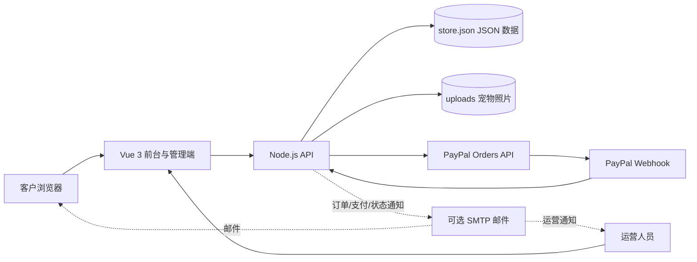
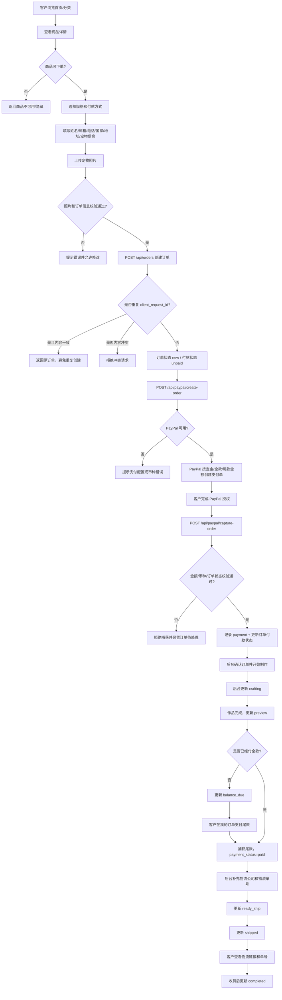
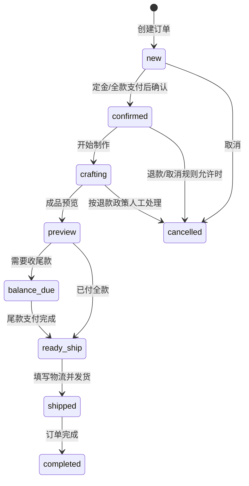
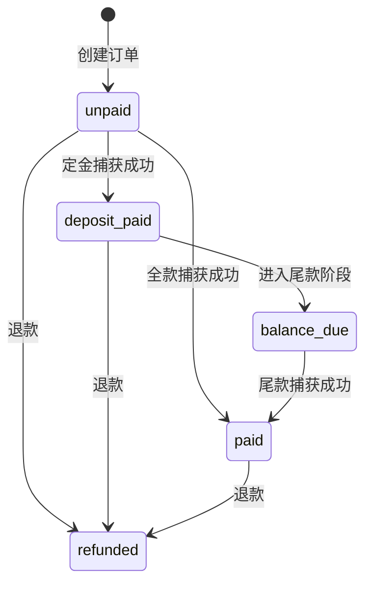
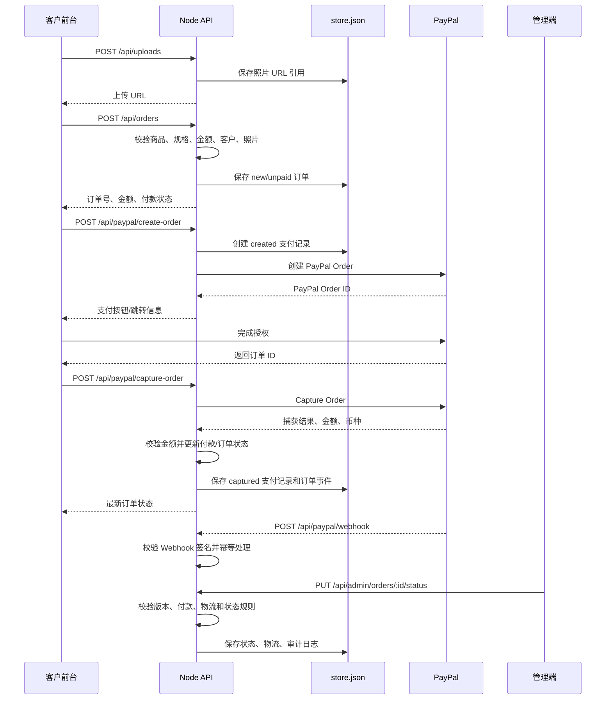
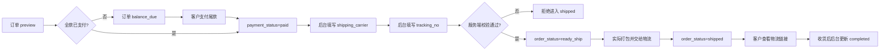

# 已完成功能与订单全流程

本文档按当前仓库代码整理，说明已经可以使用的功能、客户购买到收货的完整链路，以及前台、API、PayPal、后台之间的关系。

## 一、系统整体结构



当前线上实际主链路是 `Vue 3 + Node API + JSON 文件 + 本地上传目录`。Rust/Axum、PostgreSQL 和 Docker Compose 仍属于迁移准备，不是当前订单运行时。

## 二、已完成的功能范围

### 客户前台

- 首页、Hero、制作流程、客户评价、FAQ、博客和政策页面。
- 商品分类、大分类/子分类、场景筛选、价格和商品详情。
- 商品 SEO 标题、描述、ALT 文本、Product JSON-LD 和分类 ItemList JSON-LD。
- 中文、英文、韩文界面和内容回退。
- 主题色切换：White、Cream、Sage、Rose、Dark。
- 宠物照片上传，支持 JPEG、PNG、WebP，限制单文件 8 MB、最多 12 张，并校验图片文件签名。
- 订单表单草稿保存、重复提交幂等、商品/规格/金额/客户信息校验。
- PayPal 定金、全款和尾款支付。
- 用户登录后按邮箱查看订单、支付状态、制作进度、物流单号和客服上下文。
- 客服联系方式、规则型多语言机器人问答。

### 订单与支付

- 创建订单后生成唯一订单号和客户请求幂等 ID。
- 支持 `deposit` 定金、`full` 全款、`balance` 尾款三类付款意图。
- PayPal 支持：创建订单、跳转/按钮支付、捕获支付、金额币种校验、Webhook 验证和支付幂等。
- 支持本地 PayPal mock，用于开发和 E2E 测试。
- 支付后记录支付记录、支付状态、已付金额、PayPal 订单号和捕获号。
- 可选 SMTP 通知：新订单、付款完成、订单状态变化、后台手工付款状态变化。

### 管理端

- 概览指标：订单、未付款、待尾款、制作中、待发货、收入和多币种收入。
- 用户管理：搜索、筛选、标签、跟进记录、备注、阻止用户和导出。
- 分类管理：新增、编辑、上下架、删除保护。
- 商品管理：规格、价格、图片、分类、SEO、标签、上下架、删除保护。
- 订单管理：搜索、状态筛选、付款筛选、异常标记、备注、物流公司、物流单号、导出。
- 状态/付款流转保护：并发版本校验、取消/退款/完成锁定、发货前全款校验、物流字段校验。
- 站点配置：品牌、联系方式、政策、FAQ、评价、博客、主题、PayPal、Google 配置。
- 备份、脱敏备份、恢复 dry-run、数据清理和管理员审计日志。
- 管理员角色：`owner`、`admin`、`viewer`。

## 三、客户购买到收货的主流程



## 四、订单状态与付款状态

### 订单状态 `order_status`



当前代码使用的订单状态值：

| 状态值 | 含义 | 主要操作方 |
| --- | --- | --- |
| `new` | 新订单，待确认 | 后台 |
| `confirmed` | 已确认，准备进入制作 | 后台/支付回调 |
| `crafting` | 制作中 | 后台 |
| `preview` | 等待客户确认成品预览 | 后台/客服 |
| `balance_due` | 等待尾款 | 后台/系统 |
| `ready_ship` | 已满足发货条件，待发货 | 后台 |
| `shipped` | 已发货 | 后台 |
| `completed` | 订单完成 | 后台 |
| `cancelled` | 已取消 | 后台 |

### 付款状态 `payment_status`



| 状态值 | 含义 |
| --- | --- |
| `unpaid` | 尚未付款 |
| `deposit_paid` | 定金已支付，仍可能有尾款 |
| `balance_due` | 已进入尾款阶段 |
| `paid` | 订单已经付清 |
| `refunded` | 已退款 |

订单状态和付款状态不是同一个字段。例如：

- `order_status=preview`、`payment_status=deposit_paid`：成品待确认且待付尾款。
- `order_status=ready_ship`、`payment_status=paid`：已经付清，准备发货。
- `order_status=shipped`、`payment_status=paid`：已经发货。

## 五、订单创建与支付接口链路



## 六、发货流程重点



发货前服务端会重点校验：

- 订单不能是 `cancelled` 或 `refunded`。
- 订单不能仍处于未付款状态。
- 发货/完成前必须已经付清全款。
- `shipping_carrier` 和 `tracking_no` 必须存在。
- 订单版本不能过期，避免两个管理员覆盖彼此修改。
- 已发货或已完成订单不能把付款状态降级。

物流链接由站点配置中的模板生成，例如：

```text
https://t.17track.net/en#nums={tracking}
```

系统将 `{tracking}` 替换为经过 URL 编码的物流单号，客户可以在“我的订单”查看。

## 七、客服/后台实际参与的环节

当前系统不是完全无人值守电商，以下节点需要运营人员操作：

1. 确认客户照片、尺寸和定制要求。
2. 将订单从 `confirmed` 推进到 `crafting`。
3. 制作完成后将订单更新为 `preview`，通过客服发送或确认预览。
4. 客户确认成品后，进入 `balance_due` 或 `ready_ship`。
5. 确认尾款到账、收货地址和物流信息。
6. 实际发货后更新 `shipped` 并填写物流单号。
7. 收货或售后完成后更新 `completed`。

## 八、已完成与尚未完全自动化的边界

### 已完成

- 从商品浏览到订单创建。
- 宠物照片上传和引用保存。
- 定金、全款、尾款计算和 PayPal 支付。
- PayPal 捕获、Webhook、幂等和金额校验。
- 客户查看订单进度和物流。
- 后台订单状态、付款状态、备注和物流维护。
- 发货前全款和物流字段保护。
- 审计记录、备份恢复和可选订单邮件通知。

### 仍依赖人工或外部条件

- 真实制作和预览图片确认：目前由人工客服/后台推进，没有独立的客户预览确认按钮和预览文件管理接口。
- 实际打包、交给物流和收货确认：系统记录状态，不会自动调用物流承运商。
- 真实 SMTP、Google OAuth、PayPal Live、HTTPS、正式域名：需要部署环境配置。
- PostgreSQL 和对象存储迁移：已有准备文档/导出能力，当前运行时仍使用 JSON 和本地上传目录。

## 九、当前业务闭环结论

当前订单链路已经形成完整的 MVP 业务闭环：

```text
浏览商品
  -> 填写需求并上传照片
  -> 创建订单
  -> 支付定金或全款
  -> 后台确认并制作
  -> 预览确认
  -> 支付尾款
  -> 填写物流并发货
  -> 客户查看物流
  -> 后台完成订单
```

其中“支付、状态、金额、物流条件”已经由系统控制；“照片确认、制作、预览沟通、实际发货、收货确认”仍是运营人员参与的业务环节。
