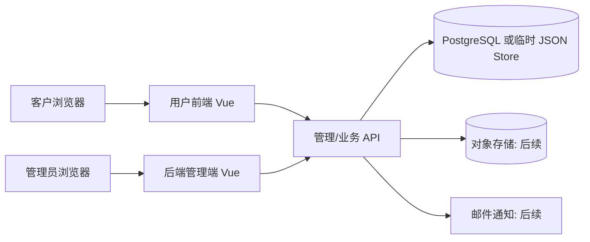
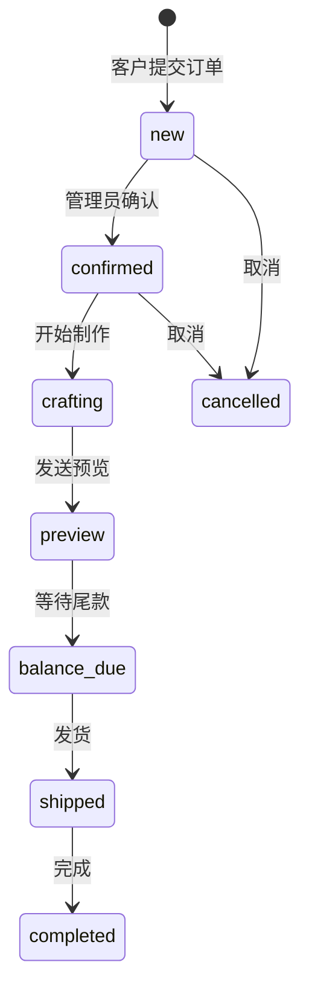
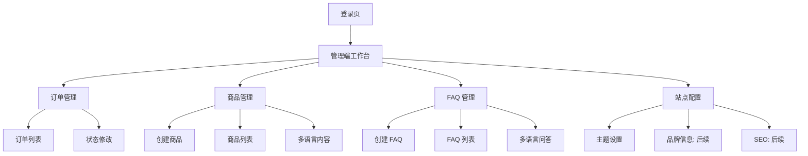

# 模块设计

## 1. 总体架构

## 2. 用户前端模块

| 模块 | 页面/组件 | 说明 |
| --- | --- | --- |
| 品牌首页 | `Home.vue` | 首屏、卖点、商品、流程、FAQ |
| 商品展示 | 首页商品区 | 按语言拉取商品列表 |
| 定制流程 | 首页流程区 | 展示下单、确认、制作、发货流程 |
| FAQ | 首页 FAQ 区 | 按语言拉取 FAQ |
| 下单 | `Order.vue` | 提交订单，计算付款金额 |
| 多语言 | `i18n.ts` | 页面静态文案切换 |
| API 客户端 | `api.ts` | 统一封装请求和 token |

## 3. 后端管理端模块

| 模块 | 页面/接口 | 说明 |
| --- | --- | --- |
| 管理登录 | `AdminLogin.vue` / `/api/admin/login` | 邮箱密码登录 |
| 管理首页 | `AdminDashboard.vue` | 后台主容器和标签页 |
| 订单管理 | `/api/admin/orders` | 订单列表和状态修改 |
| 商品管理 | `/api/products` | 商品创建、列表、编辑、删除 |
| FAQ 管理 | `/api/faqs` | FAQ 创建、列表、编辑、删除 |
| 站点配置 | `/api/admin/site` | 主题和站点配置 |
| 鉴权 | Bearer Token | 管理接口鉴权 |

## 4. 订单状态流

## 5. 管理端信息架构

