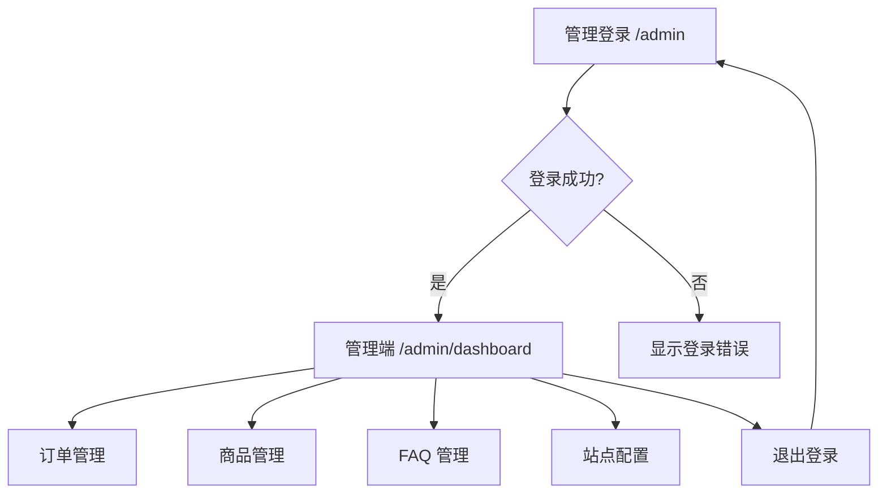
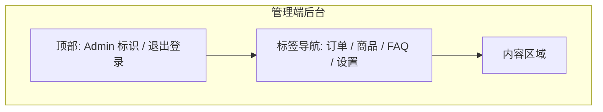
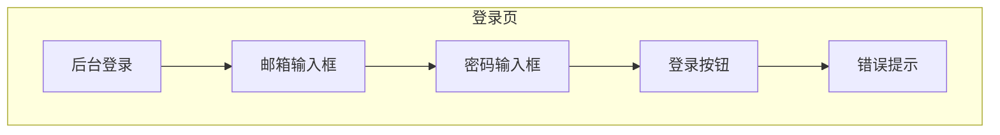
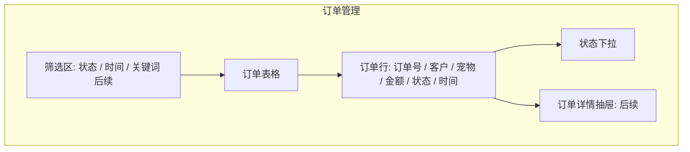
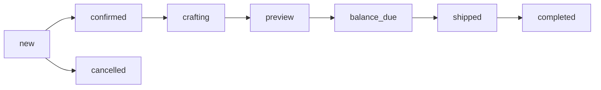
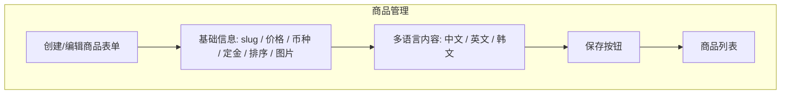
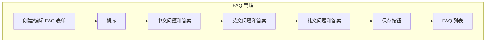
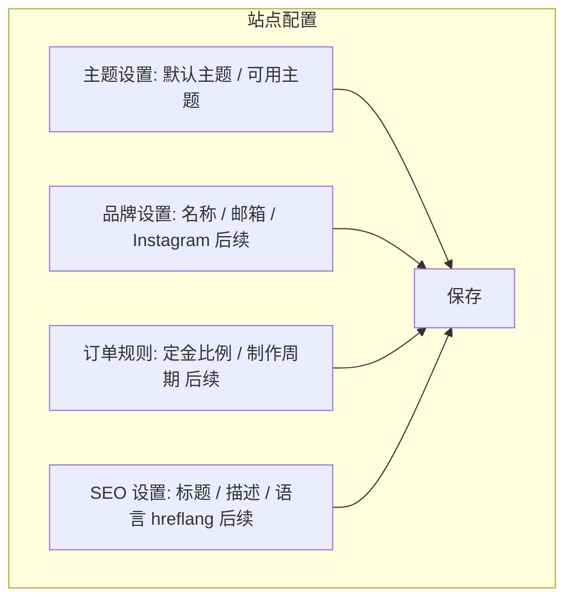
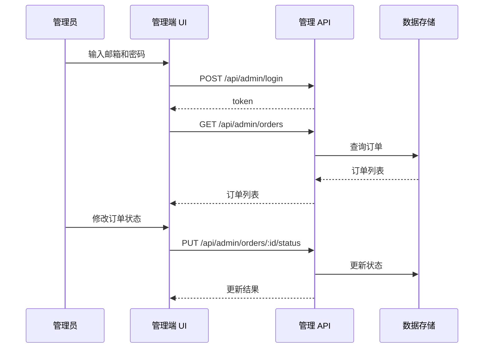

# 后端管理端原型图

## 1. 管理端定位

后端在本项目中指“管理端后台系统”，由后台 UI 和管理 API 组成。管理员通过浏览器进入后台，对订单、商品、FAQ 和站点配置进行运营管理。

## 2. 页面流程

## 3. 管理端总布局原型

## 4. 登录页原型

## 5. 订单管理原型

订单状态：

## 6. 商品管理原型

## 7. FAQ 管理原型

## 8. 站点配置原型

## 9. 管理端接口调用关系

## 10. 后续后台增强清单

| 模块 | 增强项 |
| --- | --- |
| 登录 | 修改密码、重置密码、登录过期提醒 |
| 订单 | 详情页、内部备注、客户沟通记录、照片预览 |
| 商品 | 编辑、删除、上下架、规格模板、库存/产能 |
| FAQ | 编辑、删除、启停、批量排序 |
| 设置 | 品牌配置、SEO、社交链接、邮件模板 |
| 数据 | 仪表盘统计、订单趋势、销售金额 |
