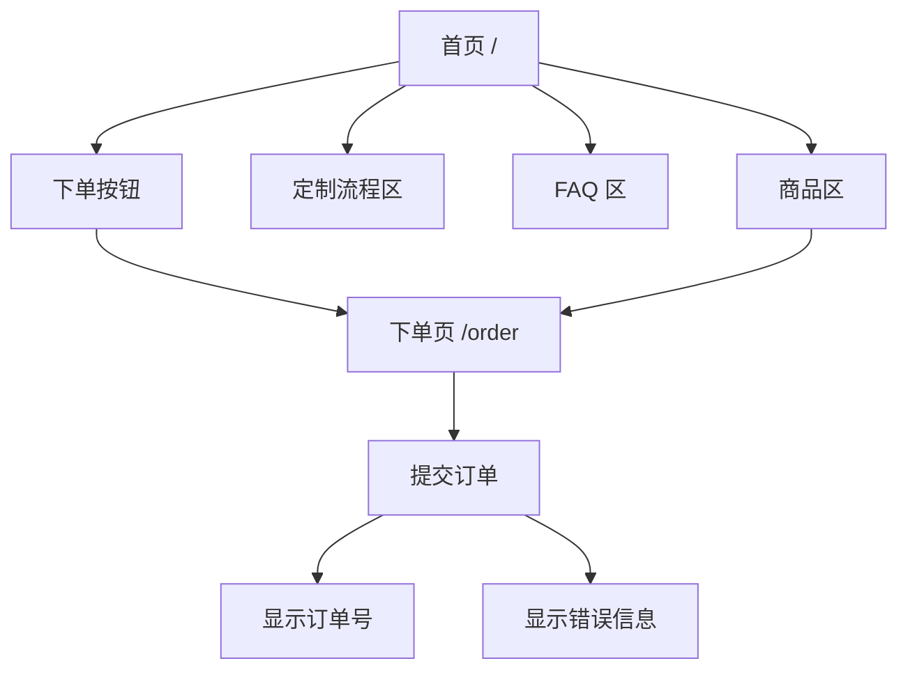
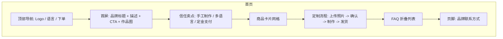
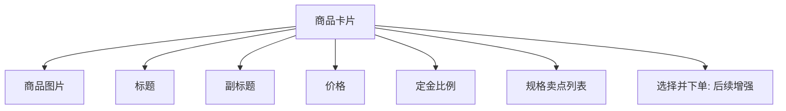
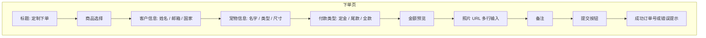
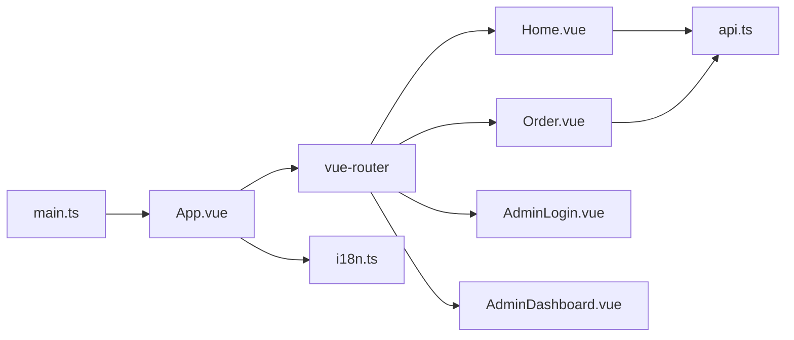

# 用户前端原型图

## 1. 页面流程

## 2. 首页低保真原型

## 3. 商品卡片结构

## 4. 下单页低保真原型

## 5. 前端模块组件关系

## 6. 用户端交互状态

| 场景 | 状态 | UI 表现 |
| --- | --- | --- |
| 加载商品 | loading | 显示 Loading |
| 切换语言 | reload | 重新请求商品和 FAQ |
| 未选择商品 | disabled amount | 金额为 0 或不显示 |
| 下单成功 | success | 显示订单号 |
| 下单失败 | error | 显示后端错误信息 |
